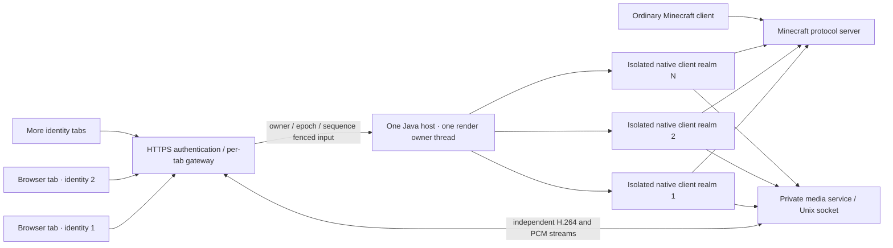

# Runtime architecture and boundaries

MultiCraft is a client-side runtime plus an authenticated browser gateway. A
Minecraft server does not need a plugin to distinguish the MultiCraft clients
from ordinary protocol clients. Server rules and features still depend on the
actual game version and server configuration.

## Java ownership

One host JVM loads each Minecraft, Blaze3D and RenderPearl session through its
own child-first class loader. Mutable player, connection, level, UI and audio
objects belong to their respective realms. A single owner thread serially calls
the original per-frame methods and executes native control mutations. HTTP
handlers enqueue bounded requests; they do not call rendering or game mutation
from request threads.

The fixed-version adapter validates the original client SHA-256, then applies a
narrow in-memory Java Class-File API transformation. Original construction,
resource loading, networking, screens and rendering remain native. The owned
adapter source does not include or redistribute the original game classes. A
Minecraft update therefore requires an explicit adapter/hash update and new
native validation; changing a version string is insufficient.

LWJGL JNI bindings and the Vulkan loader are process-level facilities. The
loader is initialized once. Each session currently creates a distinct Vulkan
device/surface/swapchain and its own scene resources. The host checks the actual
original backend/device information and the session's real SDL display rather
than treating an encoder's existence as proof that the game selected the GPU.

## Window and input ownership

The private compositor creates independent physical outputs and encoder capture
views. Physical and capture-view IDs are separate namespaces. Each exact native
window title is assigned to its configured physical output. SDL's actual display
is matched to the output bounds/origin; enumeration order is not assumed stable.
The host then verifies the actual display ID for that slot. Reserved grid
cells keep a resized output from changing a peer's geometry.

A player owns a session through the authenticated account-to-slot mapping. The
gateway and host fence input by runtime generation/owner, connection epoch,
controller lease and monotonically increasing sequence. An old socket or delayed
release must not mutate a replacement connection. Held keys are released on the
owning connection's departure. Clipboard and held native key state are also
per-realm; the shared physical Wayland seat is not used as a global player input
channel.

The browser maps pointer coordinates from the displayed canvas/video content to
the actual native window dimensions, accounting for letterboxing and CSS size.
GUI input is absolute; captured first-person input is relative. Pointer Lock and
Fullscreen are independent APIs. Entering pointer capture does not enter
fullscreen, and F8 release does not exit fullscreen.

## Streams and configuration

Each slot has its own capture, encoder callback state, bounded queues, decoder,
audio context and connection lifetime. H.264 WebSocket frames carry a monotonic
source timestamp and IDR flag. The browser asks for a new keyframe after a
recovery condition; a slow consumer cannot build an unlimited queue of stale
delta frames.

A five-field stream request contains `width`, `height`, `fps`, `bitrateKbps` and
`adaptive`. Both gateway and media validate it against OP policy. A native apply
request uses `requestId` and `expectedGeneration`, and returns the matched
acknowledgement with the actual effective parameters. The caller must surface
failure/rollback instead of presenting a saved request as applied.

Bitrate and FPS changes use the pinned capture API's native updates. Resolution
changes stop only the owning capture, resize its physical output and recreate
its view/capture; peer output geometry remains fixed. The result is checked
against the realized capture geometry. This path changes the game render
resolution; it is not a downstream scaler or a crop.

Adaptive bitrate uses bounded browser receiver feedback tied to timestamps that
were actually sent for the current generation. It operates below the user's
requested bitrate ceiling and OP cap. Encoded frames, socket sends, browser
decode acknowledgements and native Minecraft updates are different measurements.
A 1000 fps request limit does not promise 1000 distinct rendered or decoded
frames per second.

## Audio isolation

Every realm has an OpenAL Soft loopback device/context at 48 kHz, stereo, signed
16-bit little endian. The original native game sound engine and spatial listener
remain in that realm. Thread-local OpenAL context/capability binding and resource
epochs prevent an asynchronous cleanup from acting on another client's recycled
native resource.

A bounded sampler/ring feeds one PCM WebSocket per slot. Packets include audio
epoch and sample-frame index; discontinuities reset the browser scheduling clock.
The current alpha sends uncompressed PCM, approximately 1.536 Mbps per active
session before framing. It does not claim an Opus or WebRTC transport. Native
isolation, transport decoding and actually audible playback are separately
checked.

## Lifecycle and the current platform workaround

A normal disconnect closes that session's actual network connection and can
reconnect in the same slot. A terminal close is irreversible within the current
startup pool. Recreating a terminal slot or changing the slot list requires a
pool restart.

The current GPU/Wayland stack showed a driver failure when one realm destroyed
its Vulkan instance while peers were still active, and a separate final global
SDL shutdown failure. The explicit `defer-native` mode retires the exact Vulkan
instance and SDL window destruction until every realm has closed. It still
closes the per-client renderer/device/surface, network and audio resources
through their original cleanup paths.

The `process-exit` SDL policy then requires all registered client/native/audio
cleanup acknowledgements, real release of all registered instance/window
handles, empty deferred queues, no live audio sampler and no failed cleanup. Only
when those gates succeed does the owner skip the final process-global
`SDL_Quit`, return normally from Java and let the OS reclaim SDL's remaining
process state. Incomplete cleanup fails the success path. There is no
`Runtime.halt` and no silent conversion of a failure into a clean receipt.

This is a documented platform compatibility policy, not an upstream fix or a
claim that an arbitrary native library can safely tear down in every order.
Tests must cover closing either an early or late slot while peers remain live,
followed by full shutdown and an actual process exit receipt.

The failed four-client startup also exposed an unresolved native cleanup race
while GPU pipeline compilation was still in flight. The controlled normal
shutdown policy is not proof that an abort during partial initialization is
safe. The [release validation record](release-validation.md) retains this failure
and the separate functional/performance outcomes.

## Future work

The next rendering stage can investigate common asset caches, shared geometry,
shared acceleration structures and multi-view ray tracing. Those require new
ownership, visibility and temporal-history contracts. Session-specific UI,
post-processing history, audio and inputs must stay isolated. Any resource or
energy saving claim needs a measured baseline under matching scene, resolution,
frame rate and power instrumentation.

Client-side Microsoft login, broader native host platforms, compressed audio,
mod/shader compatibility and dynamic slot creation are also future work. They
are not advertised as completed features of this alpha.
